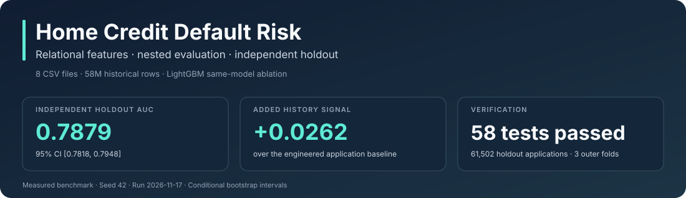
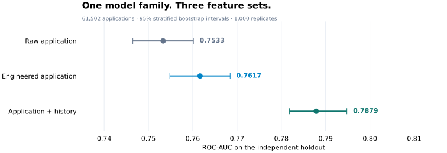
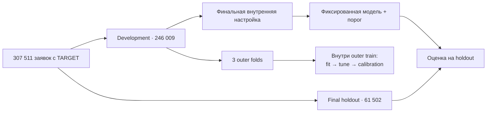

# Home Credit Default Risk

Предсказание платёжных трудностей по анкете и истории клиента. Проект исследует,
сколько добавляют связанные таблицы кредитов и платежей при одинаковой модели
и заранее определённой процедуре оценки.



[Результаты](RESULTS.md) · [Методика](docs/methodology.md) · [Данные](DATA_ACCESS.md) · [Notebook](main.ipynb) · [Проверки](VALIDATION.md)

## Результат на независимом holdout

**61 502 заявки** отложены до настройки. Остальные **246 009** использованы для
вложенной оценки и обучения. Все три строки — **LightGBM** с одинаковыми
разбиениями, бюджетом настройки и правилом отбора признаков.

| Признаки | ROC-AUC | 95% bootstrap-интервал | Average precision |
|---|---:|---:|---:|
| Исходная анкета — baseline | 0.753314 | [0.746473; 0.760159] | 0.236246 |
| Engineered-анкета | 0.761651 | [0.754833; 0.768448] | 0.246585 |
| Анкета + история | **0.787863** | **[0.781843; 0.794796]** | **0.288700** |



Добавление истории к engineered-анкете дало **+0.026211 AUC** с парным 95%
интервалом **[+0.022616; +0.029782]**. Полная разница history–raw включает также
инженерию анкеты и составляет +0.034549. Сравнение одного семейства моделей
позволяет отдельно оценить пользу признаков, не смешивая её со сменой алгоритма.

Основная политика `selected` выбрала history-ветку **на внутренних данных**.
Финальный holdout использован после фиксации модели и порога. Интервалы получены
парным стратифицированным bootstrap, 1000 повторов; они условны на фиксированных
моделях и числах классов. Подробные таблицы — в [отчёте](RESULTS.md), исходные
агрегированные значения — в [JSON](reports/home-credit-full-001.json).

## Что реализовано

- **История клиента:** bureau, прошлые заявки, POS/cash, карты и платежи;
  агрегаты по владельцу и временным срезам, отношения к доходу/сумме кредита.
- **Корректный учёт взносов:** объединение частичных платежей, сохранение
  неоплаченных обязательств, дата полного погашения по накопленной сумме.
- **Обучение внутри folds:** vocabulary one-hot, фильтры и supervised
  feature selection не используют оценочную часть.
- **Отдельный порог:** empirical cost threshold на calibration, включая
  равные скоры и решения «одобрить всех» / «отказать всем».
- **Воспроизводимость:** seed, предварительный план, hashes входов/исходников,
  журнал разбиений, готовая модель и прогнозы сохраняются локально.
- **Проверки:** 58 локально пройденных тестов — утечки, разбиения, агрегация,
  пороги, CLI, сериализация и статистический расчёт AUC.

## Как устроена оценка



На `fit` обучаются преобразования и LightGBM probe. `Tune` выбирает сложность,
число итераций и ветку признаков. Затем преобразования и модель переобучаются
на `fit+tune` с фиксированным числом итераций; `calibration` выбирает только порог.
Outer validation и final holdout не участвуют в этих решениях.

Это **nested evaluation с внутренними holdout-разбиениями**, не полный inner
K-fold поиск. После выбора порога модель не дообучается на calibration.
Submission создаётся той же development-моделью, которая оценивалась на holdout.
Подробности, проверки владельцев и group/time API — в [методике](docs/methodology.md).

## Запуск

Проверено на **Python 3.13.15 / macOS arm64 / 16 GiB RAM**. Требуется Python 3.11+.
Полный зафиксированный запуск занял **19.6 мин** при 4 потоках; это измерение
для данной конфигурации, без скачивания данных, а не обещание времени на другом ПК.

```bash
git clone --branch CreditScoring https://github.com/SwanGibbon/CreditScoring.git
cd CreditScoring
python3.13 -m venv .venv
source .venv/bin/activate
python -m pip install -r requirements.txt
python -m pytest -q
python -m jupyterlab main.ipynb
```

Notebook по умолчанию выполняет небольшой **синтетический smoke-run** без
датасета. Отдельный раздел показывает проверенные реальные результаты из
публичного JSON без повторного обучения. Синтетические метрики обозначены отдельно.

Для реального запуска самостоятельно получите восемь CSV из
[Home Credit Default Risk](https://www.kaggle.com/competitions/home-credit-default-risk/data)
в рамках своего доступа и поместите их в `home-credit-default-risk/`.
Список файлов и схема связей — [DATA_ACCESS.md](DATA_ACCESS.md).

```bash
python -m credit_scoring.run --check-data
python -m credit_scoring.run \
  --outer-folds 3 --holdout-folds 5 --max-rounds 600 --patience 50 \
  --probe-rounds 100 --top-k 500 --threads 4 --seed 42 \
  --output artifacts/reproduction-001 --submission
```

Команда соответствует опубликованному эксперименту; bare CLI имеет другие
defaults, описанные в методике. Существующие результаты и планы не перезаписываются.
Запуск сохраняет метрики, OOF/holdout-прогнозы, audit, `final_policy.joblib` и
`submission.csv`. Эти файлы остаются локально и исключены из Git.

XGBoost/CatBoost доступны через `requirements-optional.txt` и `--families`.
С ними локально пройден полный набор из 58 тестов; без optional-зависимостей
два соответствующих теста пропускаются. **Реальные метрики выше получены только
для LightGBM** — сравнение качества других семейств здесь не заявляется.

Агрегированный отчёт и рисунки можно обновить из завершённого локального запуска:

```bash
python scripts/export_report.py artifacts/reproduction-001 \
  --output reports/home-credit-full-001.json
python -m pip install -r requirements-report.txt
python scripts/render_report.py
```

## Структура

```text
main.ipynb                    walkthrough + проверенные результаты
credit_scoring/
  features.py                 признаки и проверки связей
  installments.py             SQLite-агрегация частичных платежей
  evaluation.py               fold-local preprocessing, tuning и CV
  independent.py              финальный независимый holdout
  protocol.py                 splits, метрики, cost/threshold
  run.py                      CLI, планы и сохранение модели
scripts/                      bootstrap, экспорт отчёта, SVG
reports/home-credit-full-001.json  публичные агрегированные результаты
docs/                         методика и лёгкие статические графики
tests/                        синтетические и сквозные проверки
```

## Границы результата

- **IID benchmark:** абсолютных дат текущих заявок нет; перенос во времени
  и скрытые повторные заёмщики под разными application IDs не проверены.
- **Один зафиксированный holdout:** он уже просмотрен. Будущие изменения
  требуют нового независимого подтверждения качества.
- **Учебная экономика:** цена ошибок 10:1 условна; cost не является денежным
  убытком. TARGET означает payment difficulties соревнования.
- **Калибровка порога:** probability calibration методом Platt/isotonic не проводилась.
- **Точность названий:** `AMT_ANNUITY / AMT_CREDIT` — отношение аннуитетного платежа
  к сумме кредита, не фактический срок договора.

Старые утверждения о «+0.04 только от истории» заменены измеренным same-model
сравнением. Точное смещение прежней оценки неизвестно: её сохранённых outputs не было.
