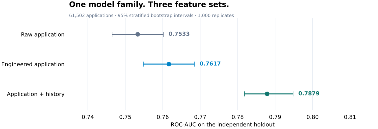

# Отчёт: Home Credit Default Risk

Зафиксированный реальный эксперимент `home-credit-full-001`, 2026-11-17.
Все значения получены выполнением pipeline на восьми CSV. Публичный
[машиночитаемый отчёт](reports/home-credit-full-001.json) содержит агрегаты,
параметры, версии и hashes; строки клиентов и тяжёлые артефакты не публикуются.

## Независимая оценка

307 511 размеченных заявок разделены до обучения: development — 246 009,
final holdout — 61 502. `selected` заранее объявлена основной политикой
внутреннего выбора; на финальном development она выбрала history LightGBM.

| Ветка LightGBM | ROC-AUC | 95% интервал | AP | Brier | Log loss |
|---|---:|---:|---:|---:|---:|
| Raw-анкета | 0.753314 | [0.746473; 0.760159] | 0.236246 | 0.068141 | 0.247582 |
| Engineered-анкета | 0.761651 | [0.754833; 0.768448] | 0.246585 | 0.067656 | 0.245181 |
| Анкета + история | 0.787863 | [0.781843; 0.794796] | 0.288700 | 0.065626 | 0.236443 |

Модель, features, число итераций и threshold фиксировались до holdout-оценки.
Итоговая модель обучена на 184 507 development-строках; 61 502 development-строки
оставлены для выбора порога. Final holdout не участвовал ни в одном fit/refit.

## Парная same-model ablation

| Сравнение | Δ AUC | 95% парный интервал |
|---|---:|---:|---:|
| История сверх engineered-анкеты | +0.026211 | [0.022616; 0.029782] |
| Инженерия анкеты сверх raw | +0.008337 | [0.005972; 0.010795] |
| История + инженерия анкеты сверх raw | +0.034549 | [0.030281; 0.038721] |

Семейство моделей, partitions, бюджет настройки и правило top-K одинаковы.
Каждая ветка настраивается внутри train. Разница history–application относится
к добавлению истории в этой процедуре; history–raw включает инженерию анкеты.
Старое утверждение о +0.04 только от истории заменено этим измерением.
Размер смещения первоначальной оценки неизвестен: её сохранённых outputs не было.

## Неопределённость

Парный стратифицированный percentile bootstrap: 1000 повторов, seed 20261117.
Одинаковые веса использованы для всех моделей, ties учитываются вместе.
Интервалы условны на фиксированных моделях и числах классов, предполагают IID
и не покрывают повторное обучение, drift или скрытые borrower groups.
По этим интервалам не выбирались новый победитель или threshold.

## Development nested CV

| Ветка | Средняя AUC | Std между folds |
|---|---:|---:|
| Raw-анкета | 0.754328 | 0.004482 |
| Engineered-анкета | 0.761618 | 0.003176 |
| Анкета + история | 0.785386 | 0.004032 |

Это три outer folds на development, а не часть final holdout. Std — разброс
folds, не доверительный интервал. Внутренние разбиения — holdouts, не полный
inner K-fold search. Подробности — [методика](docs/methodology.md).

## Решение при учебной цене ошибок

При p >= threshold заявка отклоняется. Сценарий: approved TARGET=1 стоит 10,
rejected TARGET=0 стоит 1. Стоимость выражена в условных единицах на заявку.

| Ветка | Порог | Cost 10:1 | Одобрено | TARGET=1 среди одобренных |
|---|---:|---:|---:|---:|
| Raw-анкета | 0.089117 | 0.536714 | 70.83% | 4.18% |
| Engineered-анкета | 0.090031 | 0.525609 | 71.20% | 4.06% |
| Анкета + история | 0.082938 | 0.485675 | 70.03% | 3.46% |

Порог выбирался только на calibration и применялся к той же модели.
Cost не является измеренным денежным убытком: экспозиция, доходность и взыскания
не моделируются. TARGET — payment difficulties соревнования, не обязательно
юридический дефолт. Platt/isotonic probability calibration не выполнялась.

## Воспроизведение

Полный запуск: 1176 с / 19.6 мин без скачивания, bootstrap и проверки notebook.
Среда: Python 3.13.15, macOS arm64, 16 GiB RAM, 4 потока. Это измерение конкретного
запуска, не обещание времени на другом компьютере.

Seed 42; outer=3; inner=4; holdout=5; max rounds=600; patience=50;
probe=100; top-K=500; learning rate=0.04; leaf complexities=15/31.
Точная конфигурация и зависимости записаны в публичном JSON.

В локальном run сохраняются план до обучения, OOF/holdout predictions, audit,
model/threshold, report и submission на 48 744 test IDs. Они исключены из Git.
Публичный JSON экспортирует только агрегаты и hashes через `scripts/export_report.py`.
Графики воспроизводятся через `scripts/render_report.py`.

Hashes training sources относятся к сохранённой тренировочной версии. После
запуска поправлены CLI help, документация и представление отчёта; fitting code
не менялся. Точная локальная source-копия и полный audit сохранены отдельно.

## Ограничения

Нет абсолютной application date и проверенного person ID: forward-time перенос
и скрытые повторные лица не проверены. Holdout теперь просмотрен; будущим
изменениям требуется новое независимое подтверждение. Полное реальное сравнение
XGBoost/CatBoost не выполнялось — optional-ветки проверены synthetic-тестами.
Kaggle submission не отправлялся.
